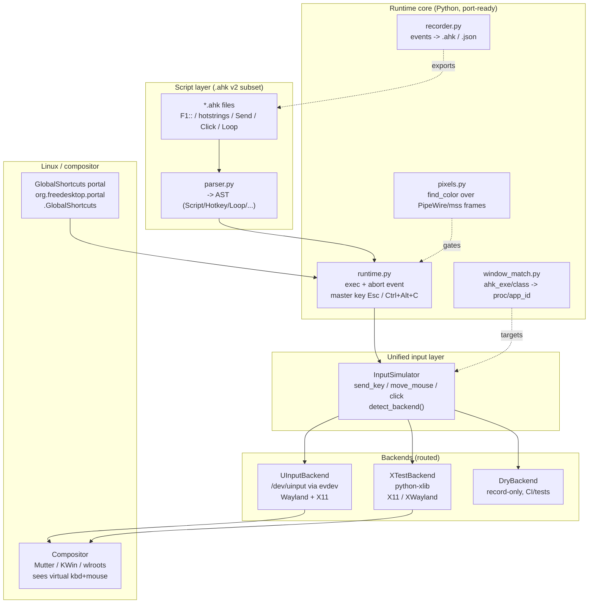

# Architecture — AHK-Linux-Bridge v0.1

## Choice record (deviation from prompt, justified by research)
- **Core in Python, not Rust/C++ (v0.1).** uinput write latency (~0.1–1 ms)
  dominates; interpreter overhead is negligible for macro rates. Python gives a
  testable MVP now and a bigger contributor pool. Hot-path port to Rust
  (`ahk-bridge-core` crate) is planned for v0.2 behind the same `InputSimulator` API.
- **No Tauri/Qt GUI yet.** Headless CLI + JSON macro format first; a
  Tauri dashboard can consume the same runtime later without protocol churn.
- **Injection = uinput (primary), XTest (X11 fallback).** libei screened out as
  primary: compositor support is uneven in 2026 (Mutter yes, KWin partial,
  wlroots largely no) and it requires portal consent flows. uinput works on
  every compositor with one udev rule.
- **Hotkeys = GlobalShortcuts portal** (`org.freedesktop.portal.GlobalShortcuts`,
  GNOME 48+/Plasma 6+), fallback X11 `XGrabKey`, fallback evdev-grab (needs `input` group).

## System diagram



## Data flow (farm macro)
1. `ahk-bridge run farm.ahk --hotkey F1` → `parse_script` → AST.
2. `Runtime.fire_hotkey("F1")` executes `Loop/Send/Click/Sleep` against `InputSimulator`.
3. `detect_backend()`: `XDG_SESSION_TYPE=x11`→x11; else uinput if `/dev/uinput`
   writable; else dry (with fix hint). Commands route without script changes.
4. Abort: any `Escape`/`Ctrl+Alt+C` listener calls `Runtime.abort()`; the next
   statement boundary raises `Aborted`, unwinding the loop in ms.

## Project layout
```
ahk-linux-bridge/
  src/ahk_bridge/        parser.py runtime.py input_abstract.py cli.py
                         hotkeys.py recorder.py window_match.py pixels.py
    backends/            uinput_backend.py xtest_backend.py dry_backend.py
  tests/                 test_parser_runtime.py test_bridge.py
  examples/              farm_loop.ahk hello.ahk macro.json
  udev/                  99-ahk-linux-bridge-uinput.rules
  docs/                  INSTALL.md  (permission guide)
  ARCHITECTURE.md        (this file)
```
